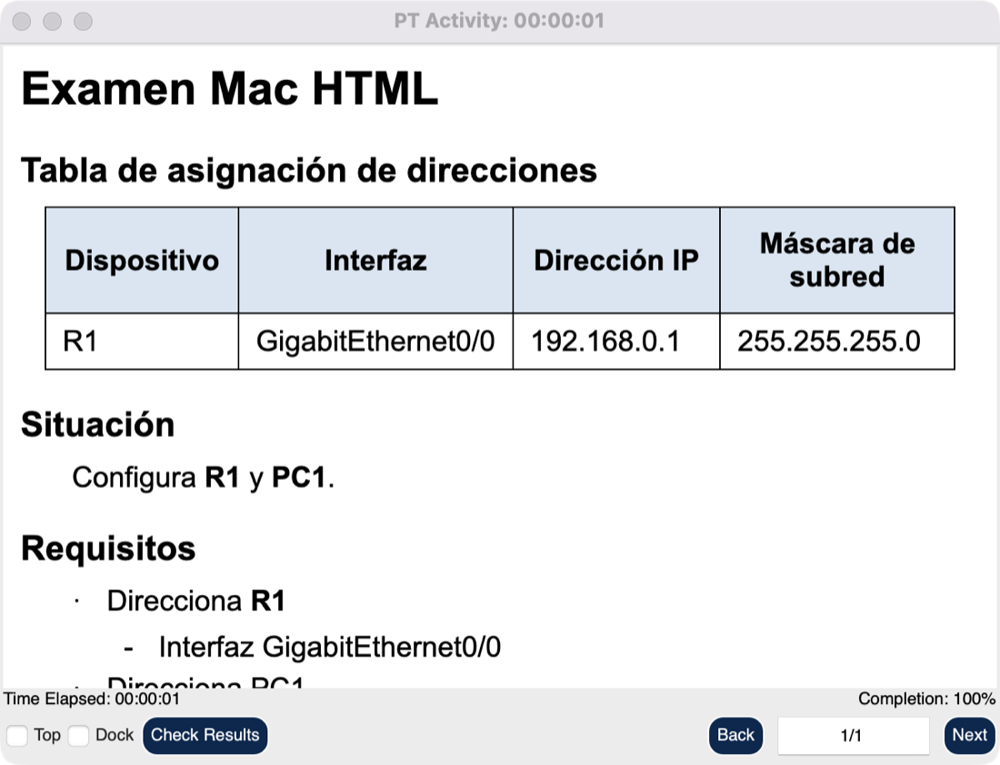

<div align="center">

# PKA Builder

**Tell your agent _"build an exam on OSPF with 2 routers"_, and Packet Tracer itself builds, marks and saves the `.pka`.**

[](#status)
[](#platforms)
[](tests/test_activity.py)
[](https://modelcontextprotocol.io)
[](LICENSE)

<br/>

<table>
<tr>
<td align="center"><strong>13</strong><br/><sub>activity tools</sub></td>
<td align="center"><strong>10</strong><br/><sub>exam steps, resumable</sub></td>
<td align="center"><strong>0 → 100 %</strong><br/><sub>graded live on macOS</sub></td>
<td align="center"><strong>3</strong><br/><sub>platforms mapped</sub></td>
<td align="center"><strong>78</strong><br/><sub>activity tests</sub></td>
</tr>
</table>

**[Platforms](#platforms)** &nbsp;•&nbsp; **[Use it](#use-it)** &nbsp;•&nbsp; **[What it can't do](#what-it-cant-do)** &nbsp;•&nbsp; **[Roadmap](#roadmap)** &nbsp;•&nbsp; **[Full reference](docs/pka-builder.md)**

</div>

---

## Status

**Beta, updated 2026-11-11.** Windows has the whole flow, macOS has it with three limits, and Linux can't create activities yet. The items below are known limits, tracked in the roadmap.

| | Ready to use | Still open |
|---|---|---|
| **macOS** | Whole exam through the MCP, reopened and graded | Focus with HTML on |
| **Windows** | Whole flow, measured before the shared driver changed | Repeat the run after that change |
| **Linux** | Offline suite only | Needs a machine with PT and a GUI driver |

## Showcase

<p align="center"></p>
<p align="center"><sub>A generated exam on macOS, reopened as a student sees it. Look at the addressing table and the bold device names: that HTML survived a save and a reopen.</sub></p>

## What it does

| | What | Tool |
|---|---|---|
| **Read** | Open a `.pka`: items, score, time, instructions | `pt_activity_open`, `pt_activity_status` |
| **Grade** | Item by item, with the score recalculated on demand | `pt_activity_check` |
| **Author** | Browse the assessment tree and choose what is graded | `pt_activity_tree`, `pt_activity_mark` |
| **Build** | Instructions, initial network, points, Wizard handling | `pt_activity_create`, `pt_activity_set_instructions`, `pt_activity_points`, `pt_activity_build_initial`, `pt_activity_exit_wizard` |
| **Finish** | Save and verify on disk, or reset to the start | `pt_activity_save`, `pt_activity_reset` |
| **All in one** | A whole exam from one spec | `pt_activity_create_exam` |

## Platforms

Measured on Packet Tracer 9.0.1. _Not tested_ means nobody has run it, not that it fails.

| Capability | Windows | macOS | Linux |
|---|---|---|---|
| Open, status, tree, mark, save, reset | ✅ | ✅ | not tested |
| Grade an activity | ✅ | ✅ | not tested |
| Create an activity and a whole exam | ✅ | ✅ | ❌ no GUI driver |
| Formatted (HTML) instructions | ✅ background | ✅ PT comes forward for seconds | ❌ |
| Plain-text instructions | not needed | ✅ background | ❌ |
| Points per item | ✅ | ❌ each item is worth 1 | ❌ |
| Connectivity tests in an exam | ✅ | ❌ skipped with a warning | ❌ |
| Grade a password-protected `.pka` | not measured | ❌ stays locked | not tested |
| Refuse commands behind a dialog | ✅ | ✅ | ❌ |
| Give the keyboard focus back | ✅ | ✅ reacts after PT jumps | ❌ |
| Offline test suite | ✅ | ✅ | ✅ |

**Needs:** Packet Tracer open with the MCP Control Center extension. Windows adds `packet-tracer-mcp[ui]`. macOS adds the Accessibility permission for the app that runs the server. On macOS, formatted instructions also need `PT_UI_ALLOW_FOREGROUND=1`.

## How it works


Packet Tracer does the work: every `.pka` is made and saved by your own copy, and this project never reads the file format. Reading, marking and grading go through PT's published Extensions API. That API has no way to create an activity, so the Wizard's window is operated like a user would, through UI Automation on Windows and Accessibility on macOS.

If a step fails, the reply names it, and `start_at` resumes from there.

## Use it

Ask your agent, or call the tool. Check the spec first with `dry_run=True`:

```python
pt_activity_create_exam(spec={
    "title": "OSPF exam",
    "situation": "Configure **R1**.",
    "addressing": [{"device": "R1", "interface": "GigabitEthernet0/0",
                    "ip": "192.168.0.1", "mask": "255.255.255.0"}],
    "requirements": ["Address R1"],
    "items": [["R1", "Ports", "GigabitEthernet0/0", "IP Address"]],
    "plan_path": "plan.json",
    "initial_commands": {"R1": ["interface GigabitEthernet0/0", "no ip address"]},
    "output_path": "/absolute/path/exam.pka",
})
```

Then open it and grade it:

```python
pt_activity_open("/absolute/path/exam.pka")
pt_activity_check(refresh=True)   # after opening, PT's score is stale until the network changes
```

## What it can't do

**On macOS**

- **Points per item.** PT's cell ignores events sent to its process, and its API only reads points.
- **Connectivity conditions.** Same reason. The spec's tests are skipped, and the exam still finishes.
- **Grade a password-protected `.pka`.** `confirmPassword` rejected the right password, though PT's own dialog rejected a wrong one and took it. The challenge key next to it is off limits on purpose.
- **Formatted instructions in the background.** Only Import Page keeps the HTML, and its panel needs PT active. Typing during those seconds would land in the panel, so it waits for 5 s without input.

**Anywhere**

- **Read or write the `.pka` format.** `pt_send_raw` refuses its bytes and the password material.
- **Open a protected activity without its password.**
- **Run without Packet Tracer.** Only the offline tests do.

**Do not retry these for HTML on macOS.** All were measured and closed: PT's API has no import by path, `insertInstructionPage()` takes no arguments, the instructions editor stores plain text, and `setNodeValue` on the Instruction node only reaches a `User Note` leaf.

## Roadmap

**Next**

- [ ] Repeat the whole exam on Windows, because the shared Wizard driver changed.
- [ ] Measure `confirmPassword` on Windows.
- [ ] Fix the focus with HTML on: PT stayed in front for about 45 s around the end of the last run.

**After that**

- [ ] macOS points and connectivity through a real double click, as an opt-in that moves the cursor.
- [ ] macOS UI mode, starting with captures, which already work on the Wizard.
- [ ] Linux live: base MCP first, on x86_64 with the Cisco `.deb` and a NetAcad login, then a GUI driver.

## Where things are

```text
src/packet_tracer_mcp/
├── adapters/mcp/tools/activity.py          the 13 tools and the exam steps
├── domain/models/exam.py                   the exam spec
├── domain/services/exam_html.py            renders the instructions
├── infrastructure/generator/activity_js.py PT API calls for activities
└── infrastructure/ui/
    ├── wizard.py                           drives the Wizard, any platform
    ├── macax.py                            macOS Accessibility backend
    └── win32.py · uia.py                   Windows backend
tests/test_activity.py                      78 tests, no Packet Tracer needed
```

**Measured traps** are in [`rough-edges.md`](skill/reference/rough-edges.md). **Scope and project terms** are in the [full reference](docs/pka-builder.md#scope).

## License

Code under the [MIT License](LICENSE). It doesn't cover Packet Tracer. This project isn't affiliated with Cisco.
