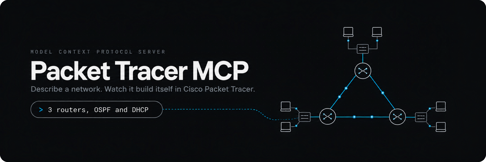
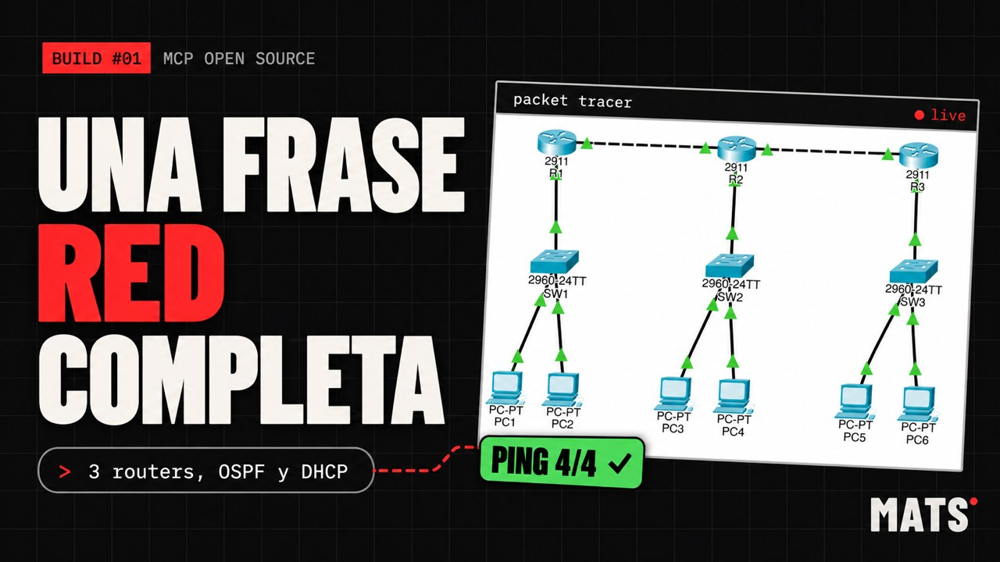
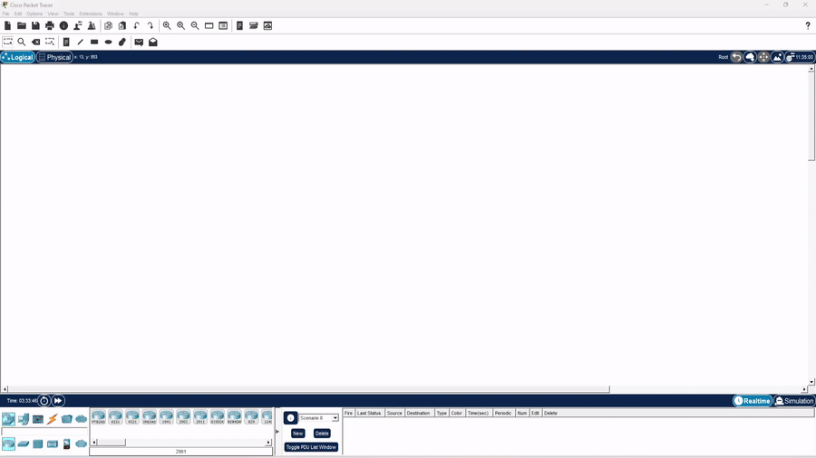

<div align="center">



**Describe a network in plain words. Your AI plans it, validates it, and builds it live in Cisco Packet Tracer — then pings it to prove it works.**

<sub>Install it by asking your agent: <i>"Install the Packet Tracer MCP from github.com/Mats2208/MCP-Packet-Tracer and set everything up for me."</i></sub>

[](https://pypi.org/project/packet-tracer-mcp/)
[](https://python.org)
[](https://modelcontextprotocol.io)
[](https://mats2208.github.io/MCP-Packet-Tracer/)
[](https://www.mcpnetwork.top)
[](https://github.com/Mats2208/MCP-Packet-Tracer/blob/main/LICENSE)
[](https://lobehub.com/mcp/mats2208-mcp-packet-tracer)

<table>
<tr>
<td align="center"><strong>109</strong><br/><sub>MCP tools</sub></td>
<td align="center"><strong>6</strong><br/><sub>MCP resources</sub></td>
<td align="center"><strong>3</strong><br/><sub>MCP prompts</sub></td>
<td align="center"><strong>74</strong><br/><sub>device models</sub></td>
<td align="center"><strong>150</strong><br/><sub>modules</sub></td>
<td align="center"><strong>15</strong><br/><sub>cable types</sub></td>
<td align="center"><strong>1,634</strong><br/><sub>offline tests</sub></td>
</tr>
</table>

</div>

---

## Video

<p align="center">
  <a href="https://youtu.be/RthD8h0CEhQ">
    
  </a>
</p>
<p align="center"><sub>▶ <a href="https://youtu.be/RthD8h0CEhQ">Watch on YouTube</a> (6 min): install, how it works, and three live examples. Spanish narration, English subtitles.</sub></p>

## Showcase

<p align="center">
  
</p>
<p align="center"><sub>From a prompt to a running topology in Packet Tracer, in real time</sub></p>

<table>
<tr>
<td width="50%">
<p align="center"></p>
<p align="center"><sub>3 routers, OSPF, DHCP and 6 PCs — planned and deployed by the agent</sub></p>
</td>
<td width="50%">
<p align="center"></p>
<p align="center"><sub>The IOS configuration it generates and applies</sub></p>
</td>
</tr>
</table>

---

## How it works

```text
"3 routers, OSPF and DHCP"
        │
        ▼
  Your AI agent ──── Claude Code, OpenCode, Codex, Cursor… (any MCP client)
        │  calls pt_* tools
        ▼
  Packet Tracer MCP ─ plans → validates → auto-fixes → generates JS + IOS config
        │  authenticated HTTP bridge, 127.0.0.1:54321
        ▼
  MCP Control Center ─ this project's PT extension, polls the bridge every 500 ms
        │  runs the JavaScript in PT's Script Engine
        ▼
  Cisco Packet Tracer ─ devices, cables and configs appear on the canvas
```

With the extension window closed, a file mailbox takes over, so PT keeps executing.
Everything stays on your machine: the bridge only listens on loopback and every call
carries a per-machine token (see [Security](#security)).

## What it can do

| | What | Tools |
|---|---|---|
| **Build** | One prompt → plan → validation → auto-fix → live deploy, with read-back of every device and link | `pt_full_build`, `pt_plan_topology`, `pt_validate_plan`, `pt_fix_plan`, `pt_live_deploy` |
| **Addressing** | /24 LANs, /30 point-to-point links, DHCP pools on routers or on a dedicated Server-PT, IPv6 dual stack | `pt_configure_dhcp_server`, `dual_stack=True` |
| **Routing** | Static (with floating backups), OSPF, EIGRP, RIP; HSRP, BGP and QoS on a live router | generated IOS, applied live; `pt_apply_hsrp`, `pt_apply_bgp`, `pt_apply_qos` |
| **Switching** | VLANs, trunks, router-on-a-stick, STP, port security, EtherChannel, AP SSID and MAC filter | `pt_apply_vlan`, `pt_apply_stp`, `pt_apply_port_security`, `pt_apply_etherchannel`, `pt_wireless_ap` |
| **Voice** | Cisco CME on a 2811 with IP phones that register (measured with a PoE 3560 and two 7960) | `pt_apply_voice` |
| **Security** | ACLs, NAT, device hardening (SSH, local users, `enable secret`, banner) and an audit of the **live** config | `pt_apply_acl`, `pt_apply_nat`, `pt_apply_hardening`, `pt_audit_security` |
| **Inside each device** | Type in a router's CLI tab, run `ping`/`ipconfig` on a PC, configure Server-PT DHCP/DNS/HTTP/FTP/EMAIL, use the Web Browser and Email apps | `pt_cli`, `pt_host_command`, `pt_server_*`, `pt_web_browser` |
| **Verify** | Real ping with parsed results, health check, plan-vs-live diff, per-port inspection; every CLI change reports which IOS lines were rejected; structured reads of routes, OSPF, ARP, CDP, STP, ACL, NAT, MAC tables and DHCP leases | `pt_verify_connectivity`, `pt_health_check`, `pt_diff`, `pt_inspect_ports`, `pt_read_routes`, `pt_read_ospf`, … |
| **Explain** | Send a simple PDU, step the simulation and read PT's own per-layer decision log for each packet | `pt_send_pdu`, `pt_simulation_mode`, `pt_simulation_step`, `pt_read_packet_trace` |
| **PKA Builder** | Open and grade `.pka` activities item by item, or build a whole exam from one spec: answer network, instructions, graded items, initial network | `pt_activity_create_exam`, `pt_activity_check`, `pt_activity_*` |
| **Document** | Canvas screenshots, notes and drawings on the canvas, `.pkt` save/open, config backup, exported plans and configs | `pt_screenshot`, `pt_add_note`, `pt_save_project`, `pt_backup_config`, `pt_export` |

All 109 tools are listed in the **[tool reference](https://mats2208.github.io/MCP-Packet-Tracer/tools/)**.

## Installation

Needs Cisco Packet Tracer 8.2+ (tested on 9.0 and 9.0.1) on Windows or macOS — see [Platforms](#platforms).

### The easy way: ask your AI agent

Open Claude Code, OpenCode, Codex or any coding agent and say:

```text
Install the Packet Tracer MCP from https://github.com/Mats2208/MCP-Packet-Tracer and set everything up for me.
```

That's it. The agent finds its instructions here, checks your OS and agent, installs the server and the
skill, and puts the extension where Packet Tracer finds it. The next time you open Packet Tracer it asks
*"detected a new script module… enable?"* — click **Yes**. That click is the only thing you do by hand.

> [!NOTE]
> **AI agent reading this?** Don't follow the manual steps below. Follow
> [`llms-install.md`](llms-install.md) — it is written for you: OS detection, every client's registration
> command, the skill, the extension, and how to verify with the user.

### Manual install

**1. Install [`uv`](https://docs.astral.sh/uv/getting-started/installation/)** — it brings its own Python, so
you don't need to install Python or touch PATH.

_macOS · Linux:_ `curl -LsSf https://astral.sh/uv/install.sh | sh`
_Windows (PowerShell):_ `powershell -ExecutionPolicy ByPass -c "irm https://astral.sh/uv/install.ps1 | iex"`

**2. Connect your MCP client** (Claude Code shown; other clients in the
[Installation docs](https://mats2208.github.io/MCP-Packet-Tracer/installation/))

```bash
claude mcp add --scope user --transport stdio packet-tracer -- uvx packet-tracer-mcp --stdio
```

_Windows PowerShell_ — quote the `--` separator, or PowerShell swallows it and Claude aborts with `error: unknown option '-m'`:

```powershell
claude mcp add --scope user --transport stdio packet-tracer "--" uvx packet-tracer-mcp --stdio
```

Verify with `claude mcp list` (look for `packet-tracer … ✓ Connected`).

**3. Install the Agent Skill** — _required in practice: without it the AI guesses model, port and API names
instead of discovering them_

```bash
uvx packet-tracer-mcp install-skill                         # Claude Code, OpenCode → ~/.claude/skills
uvx packet-tracer-mcp install-skill --dest ~/.agents/skills # Codex
```

Then restart your agent (or run `/reload-skills` in Claude Code). Details →
**[Skill docs](https://mats2208.github.io/MCP-Packet-Tracer/skill/)**.

**4. Install the live-deploy extension** — Download **`MCP-Control-Center.pts`** from
[**Releases**](https://github.com/Mats2208/MCP-Packet-Tracer/releases/latest) and drop it in Packet
Tracer's own `extensions` folder, in a subfolder (`…/extensions/MCPControlCenter/`). On macOS that is
`Cisco Packet Tracer <version>.app/Contents/extensions/`; on Windows
`C:\Program Files\Cisco Packet Tracer <version>\extensions\` (needs admin). Next time PT starts it
asks *"detected a new script module… enable?"* — click **Yes**. Or add it by hand with
**Extensions → Scripting → Configure PT Script Modules → Add…**. Full walkthrough in [Live deploy](#live-deploy) below.

> **v0.6.0+ requires extension V5 or newer** (current: V6). The bridge authenticates with a per-machine token the extension reads automatically; builds before V5 can't authenticate.

<details>
<summary>Prefer pip?</summary>

```bash
pip install packet-tracer-mcp            # then use `python -m packet_tracer_mcp --stdio` as the command
pip install "packet-tracer-mcp[ui]"      # Windows: adds UI mode and the Activity Wizard
```

Requires Python 3.11+. On macOS (Homebrew) and recent Linux distros a plain `pip install` is refused
(`externally-managed-environment`, PEP 668): use `uv` as above, or a virtualenv. With `uv`, UI mode is
`uvx --from "packet-tracer-mcp[ui]" packet-tracer-mcp --stdio`.

From source, to modify it: `git clone https://github.com/Mats2208/MCP-Packet-Tracer && cd MCP-Packet-Tracer && pip install -e .`
</details>

## Quick start

Restart your agent after installing, open **Extensions → MCP BUILDER** in Packet Tracer, and ask:

> *"Create a network with 1 switch and 2 PCs, deploy it to Packet Tracer and ping between the PCs."*

> *"Build 3 routers in a triangle with OSPF, a LAN with 2 PCs behind each one, and DHCP."*

> *"Check the network: show me R1's routing table and audit the security of every router."*

The agent calls `pt_full_build` (plan → validate → generate → deploy), then verifies with a real
ping. More in the **[Quick Start guide](https://mats2208.github.io/MCP-Packet-Tracer/quickstart/)**.

## Platforms

| | Windows | macOS | Linux |
|---|---|---|---|
| Install by agent (`llms-install.md`, PT detects the extension) | ✅ | ✅ | ⚠️ server + skill yes; extension added by hand |
| Server (`uvx packet-tracer-mcp`) | ✅ | ✅ | ✅ |
| Live deploy (HTTP bridge) | ✅ | ✅ | ✅ |
| File-bridge (extension window closed) | ✅ | ✅ | ✅ |
| Device panel (`pt_cli`, `pt_host_command`, services…) | ✅ | ✅ | ✅ |
| UI mode (open/capture device windows) | ✅ | — | — |
| Activities: open, grade, mark, save | ✅ | ✅ | not tested yet |
| Activities: create and exam (Wizard) | ✅ | ✅ HTML instructions need `PT_UI_ALLOW_FOREGROUND=1`; no points or connectivity tests | — |
| Activities: grade a password-protected `.pka` | not measured | ❌ the API rejects the right password | — |

Activities, status and limits: see [PkaIndex](PkaIndex.md).

macOS and Windows 11 were verified on Packet Tracer 9.0.1: every tool of that release ran against a live
canvas on macOS, and on Windows the agent install, both bridge channels, OSPF + DHCP builds checked with real
pings, and UI mode. The activity tools were measured on both; on macOS a whole exam was built through the MCP,
reopened and graded 0 % → 100 %. The Wizard driver is shared and changed after the Windows run, so that run is
pending. On Linux the core tools were verified live (below); the activity tools have only run offline there.

Linux was verified on 2026-11-03 with Ubuntu 26.04.1 LTS (kernel 7.0, GNOME 50 on Wayland),
Packet Tracer 9.0.1 from Cisco's `.deb`, `packet-tracer-mcp` 0.11.0 through `uvx` (uv 0.13.3)
and Claude Code 2.1.317 as the client. Both bridge channels connected (PT's webview is
QtWebEngine 6.8.7). Checked live: `pt_full_build` single LAN (4/4 devices, 3/3 links, DHCP lease)
and 3 routers with OSPF + DHCP (12/12, 12/12, 6 neighbours FULL, no convergence gaps), real pings
across LANs, `pt_cli`, `pt_host_command`, `pt_host_ip_config`, Server-PT HTTP / DNS / EMAIL,
`pt_web_browser`, `pt_health_check`, `pt_screenshot`, `pt_save_project`, and with the extension
window closed the file-bridge alone ran pings, CLI, add device + link and a DHCP lease.
Linux specifics:

- PT ships as an AppImage in `/opt/pt`, so there is no `extensions` folder to drop the module
  into: add `MCP-Control-Center.pts` with **Extensions → Scripting → Configure PT Script Modules → Add…**.
- Before the first start, accept the EULA by running `packettracer` in a terminal (launched from
  the menu it waits for an answer it never gets and no window appears). On Ubuntu 26.04 PT also
  needs `sudo apt install libopengl0 libts0t64`.
- PT reports `~/Cisco Packet Tracer 9.0.1/saves` as its save folder, which does not exist on Linux
  (its real user folder is `~/pt`). `pt_save_project` without `directory` now falls back to
  `~/pt/saves` instead of hitting PT's "No Write Permission" dialog.

## Live deploy

Live deploy runs through this project's own Packet Tracer extension, the **MCP Control Center**
(`MCP-Control-Center.pts` in [Releases](https://github.com/Mats2208/MCP-Packet-Tracer/releases/latest)). Add it
once via **Extensions → Scripting → Configure PT Script Modules → Add…**, then open
**Extensions → MCP BUILDER** in each session. It connects to the bridge by itself and reads the
token from disk — there is nothing to paste or configure.

<p align="center"></p>
<p align="center"><sub>Adding the MCP Control Center extension to Packet Tracer</sub></p>

📖 Full steps → **[Live Deploy Setup](https://mats2208.github.io/MCP-Packet-Tracer/live-deploy/)**.

## Device panel and UI mode

Once a topology is live, the agent works inside each device the way a student would: it types in
a router's **CLI** tab, runs commands in a PC's **Command Prompt**, sets **IP Configuration**,
browses with the **Web Browser** and configures a server's **Services** — all through Packet
Tracer's own API, so what it types shows up in the real CLI tab and you can take over at any time.

It is **headless by default**. On Windows, say *"show it in Packet Tracer"* (or call
`pt_ui_mode("ui")`) and every panel tool also opens the device's window on the matching tab;
`capture=True` saves a PNG. Windows are driven with UI Automation and a click posted to the
canvas — your real mouse and keyboard are never used.

## PKA Builder

The agent works with Packet Tracer activities too. It opens a `.pka`, grades it item by item and reports what
is wrong. It also builds an exam from one spec, with Packet Tracer itself doing the work: it deploys the answer
network, imports formatted instructions, marks what is graded, prepares the initial network and saves the
`.pka`. A password-protected activity stays locked without the instructor's password.

```text
"Build an exam on OSPF with 2 routers, graded on the interfaces and the neighbours."
```

Windows does the whole flow. macOS needs the Accessibility permission, HTML instructions need
`PT_UI_ALLOW_FOREGROUND=1` (Packet Tracer comes forward for a few seconds), and points per item and connectivity
tests are not available there yet. Status and scope in **[PkaIndex](PkaIndex.md)**, details in **[PKA Builder](docs/pka-builder.md)**.

## Clients

Any MCP client drives this server — Claude Code, Cursor, Claude Desktop, VS Code with
Copilot, Codex. Nothing in it is client-specific.

There is also one built **on** it: **[PacketSmith](https://github.com/Mats2208/packetsmith)**,
a terminal app that runs these tools with the network drawn beside the conversation — a
fabric tree and a canvas plan derived from the `pt_*` results themselves, so a device the
model *says* it created but did not never shows up.

| | This server alone | This server + PacketSmith |
|---|---|---|
| Where you talk | the MCP client you already use | a terminal app built for this one job |
| What you see | a chat log, plus PT in another window | split screen: reply left, live topology right |
| Topology | read out of the tool output | fabric tree and canvas plan, drawn for you |
| Tools loaded | every MCP server you have configured | this one only — measurably faster to start |
| Engine | whatever your client speaks | Claude, or ~150 providers |

**You need this server either way** — PacketSmith runs it underneath, and its setup installs
it for you. If you already live in Claude Code, you are done here; the client is for when you
want the topology in front of you instead of buried in a scrollback.

```bash
npm i -g packetsmith    # beta · MIT
```

## Credits & Acknowledgements

Live deploy runs through **our own Packet Tracer extension** — the **MCP Control
Center** (the `.pts` in [Releases](https://github.com/Mats2208/MCP-Packet-Tracer/releases/latest)).
Its Script-Engine helper layer was **inspired by**
**[PTBuilder](https://github.com/kimmknight/PTBuilder)** by
**Kim Knight ([@kimmknight](https://github.com/kimmknight))**, who pioneered driving
Packet Tracer's Script Engine from JavaScript — thanks for the groundwork. 🙏

> PTBuilder and Packet Tracer MCP are **separate, independent projects**. You install
> *our* extension, not PTBuilder. Full
> **[Credits & Attribution](https://mats2208.github.io/MCP-Packet-Tracer/credits/)**.

## Security

Driving Packet Tracer from outside means running a local HTTP bridge whose whole
job is to hand JavaScript to PT's Script Engine — code that executes with PT's
own privileges, including disk access. That makes the bridge a genuine attack
surface, not an implementation detail, and it is hardened accordingly.

**The attack this design exists to stop.** Binding to `127.0.0.1` is *not* a
security control. A `POST` with `Content-Type: text/plain` is a CORS *simple
request*: any web page open in your browser can send it to a loopback port
without a preflight and without needing to read the response. An unauthenticated
bridge therefore lets any website you visit — while Packet Tracer happens to be
open — queue arbitrary code inside it. Injection never needed to read anything
back, so same-origin policy alone never closed this.

What actually closes it is a secret the attacking page cannot guess:

| Control | Implementation |
|---|---|
| **Token on every endpoint** | Every route except `/ping` requires a shared token (`?t=` or `X-PT-Token`). Compared with `hmac.compare_digest` — constant time, no early-exit oracle. |
| **`/ping` leaks nothing** | Deliberately unauthenticated so the server can tell *who owns the port* before trusting it — but it returns only a SHA-256 **fingerprint** of the token, never the token. |
| **Foreign-bridge detection** | Before sending any payload, the server checks that `/ping` identity matches its own token fingerprint. If a stranger holds the port, it refuses to hand code to it instead of blindly trusting a `200`. |
| **DNS-rebinding defense** | The `Host` header is validated against `127.0.0.1` / `localhost` / `[::1]` + the real port. A rebound request arrives as `Host: evil.com:<port>` and is rejected. |
| **Loopback bind** | `ThreadingHTTPServer(("127.0.0.1", port))` — never `0.0.0.0`, so the bridge is not reachable from the LAN. |
| **Token at rest** | `secrets.token_urlsafe(32)`, created with `O_EXCL` (race-safe when two servers start at once) at mode `0o600`, under `%LOCALAPPDATA%` on Windows — deliberately *not* roaming `%APPDATA%`, so a loopback secret never syncs to a file server. |
| **Body size cap** | Oversized bodies are rejected with `413` and are **not** read into memory. |
| **Silent failures** | Error responses carry no CORS headers, so a hostile page cannot even distinguish *why* it failed. |
| **Tamper visibility** | Unauthorized attempts are counted and surfaced by `pt_bridge_status`, so a stale or rogue client is diagnosable instead of silent. |

Regression coverage lives in [`tests/test_bridge_security.py`](https://github.com/Mats2208/MCP-Packet-Tracer/blob/main/tests/test_bridge_security.py)
and [`tests/test_injection_regressions.py`](https://github.com/Mats2208/MCP-Packet-Tracer/blob/main/tests/test_injection_regressions.py);
the full suite runs offline with `python -m pytest` — no Packet Tracer required.

> **v0.6.0+ requires extension V5 or newer.** Versions before v0.6.0 shipped an
> unauthenticated bridge and are vulnerable to exactly the attack above.
> **Upgrade — there is no safe configuration of the old bridge.**

**Deliberate, documented behaviour:** `pt_send_raw` executes arbitrary JavaScript
inside Packet Tracer by design — it is the escape hatch for exploring the IPC
API. It is reachable only by an MCP client you have already authorised, over the
authenticated bridge. That is a capability, not a vulnerability.

Found a vulnerability? Report it privately via
[GitHub Security Advisories](https://github.com/Mats2208/MCP-Packet-Tracer/security/advisories/new),
not a public issue. [SECURITY.md](https://github.com/Mats2208/MCP-Packet-Tracer/blob/main/SECURITY.md) documents the full threat model.

## What's new

**Unreleased** — **PKA Builder**: 13 `pt_activity_*` tools open, grade and build `.pka` activities, and
`pt_activity_create_exam` builds a whole exam from one spec. The Activity Wizard now also runs on macOS.

**v0.11.0** — live reads that flag what has not converged (routes, OSPF, ARP, CDP, STP, ACL, NAT, MAC tables,
DHCP leases), real PDUs with PT's own per-layer reason, Fast Forward Time, CME voice measured end to end, HSRP,
BGP, QoS, EtherChannel, Wi-Fi AP settings, and static IPv6 on hosts.

**v0.10.0** — install by asking your agent ([`llms-install.md`](https://github.com/Mats2208/MCP-Packet-Tracer/blob/main/llms-install.md)),
the skill inside the package, and 17 device-panel tools that work inside each device. Older releases in the
**[Changelog](https://github.com/Mats2208/MCP-Packet-Tracer/blob/main/CHANGELOG.md)**.

## Contributing

See [CONTRIBUTING.md](https://github.com/Mats2208/MCP-Packet-Tracer/blob/main/CONTRIBUTING.md). The
test suite (1,634 tests) runs offline with `uv run --extra test python -m pytest` — no Packet Tracer needed.

## License

Released under the **[MIT License](https://github.com/Mats2208/MCP-Packet-Tracer/blob/main/LICENSE)** — © 2026 Mateo ([@Mats2208](https://github.com/Mats2208)).

<div align="center">

**Built with [MCP](https://modelcontextprotocol.io) · Deploys to [Cisco Packet Tracer](https://www.netacad.com/) · Script-engine logic inspired by [PTBuilder](https://github.com/kimmknight/PTBuilder)**

If this project is useful to you, star it ⭐ and share it with the community.

</div>
